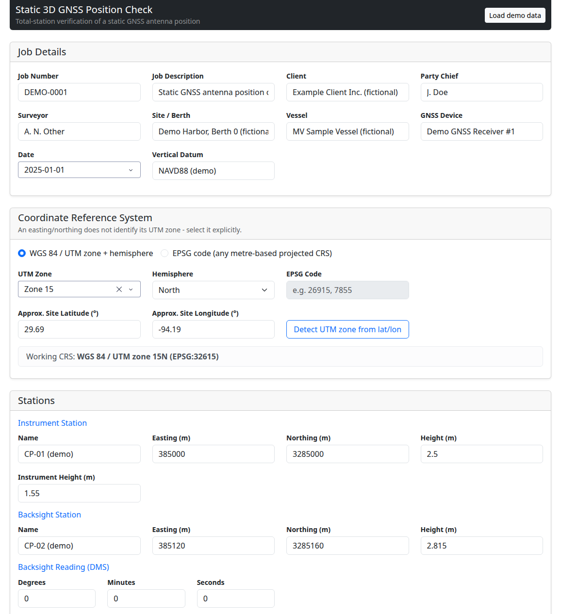
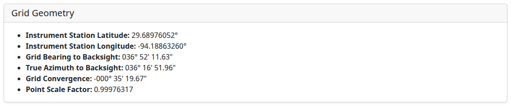
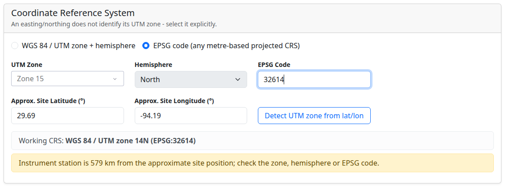
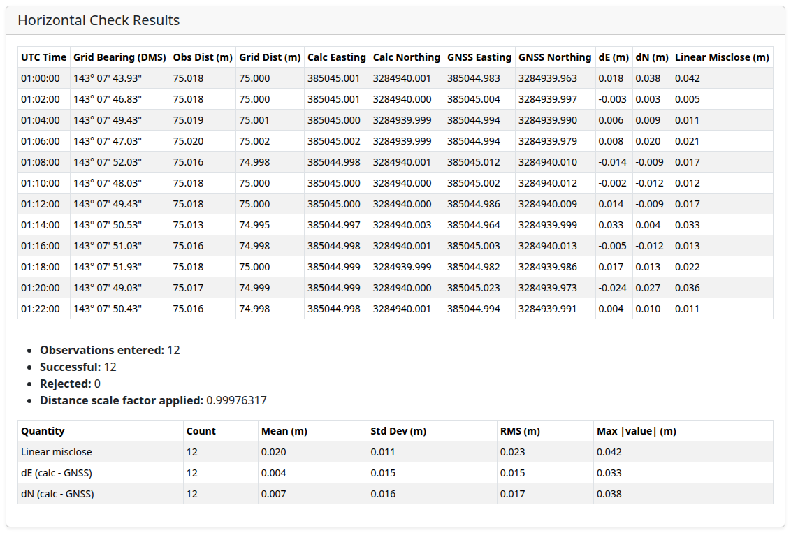

# Static 3D GNSS Position Check

[](https://github.com/mohamd764/GNSS-Static-3D-Dashboard/actions/workflows/tests.yml)


A Plotly Dash web app that verifies the position of a GNSS (DGPS) antenna, for example on a vessel alongside a
berth, by comparing it with independent total-station observations from known control points. The app works in
3D: it checks easting and northing against a radiation from the instrument station, and height against a
trigonometric height. It reports per-epoch miscloses and summary statistics, and exports a PDF report.

The grid geodesy is rigorous. Coordinates are handled in an explicit coordinate reference system (UTM zone and
hemisphere, or any metre-based EPSG grid). Grid convergence and point scale factor are computed exactly with
[PROJ](https://proj.org/) and checked in the test suite against published and independently computed reference
values.



| Grid geometry | Wrong-zone safeguard |
| --- | --- |
|  |  |



A sample PDF report generated from the demo session is in [`docs/sample-report.pdf`](docs/sample-report.pdf).

> **All data in this repository is synthetic.** The demo session uses fictional names and round-number
> coordinates. Its observations are simulated from a known antenna position with seeded random noise
> (`gnss_check/sample_data.py`).

## What it does

1. **Choose the coordinate reference system.** Pick a WGS 84 / UTM zone and hemisphere, or type an EPSG code
   (for example NAD83 / UTM 15N `26915`, NAD83 / Texas South Central (m) `32140`, or GDA2020 / MGA 55 `7855`).
   If you enter an approximate site latitude/longitude, *Detect UTM zone* fills in the zone for you, and the app
   warns if the station coordinates put the site far from that position.
2. **Enter the instrument station, the backsight station and the backsight reading.** The app shows the station's
   latitude/longitude, the grid bearing and true azimuth to the backsight, the grid convergence and the point
   scale factor.
3. **Enter the observations for each epoch:** UTC time, horizontal direction, horizontal distance, vertical
   distance, target offset, and the GNSS easting/northing/height logged at that epoch.
4. **Compute the horizontal and vertical checks,** then export the PDF report.

## The geodesy

### Why the zone must be explicit

A UTM coordinate does not encode its zone. Every one of the 60 zones uses the same false easting of 500 000 m
(and, in the southern hemisphere, a false northing of 10 000 000 m), so the same easting/northing pair is a valid
point in every zone, 6° of longitude apart. The zone therefore comes from the user, from an EPSG code, or from a
known latitude/longitude (using the standard zone rule, including the Norway 32V and Svalbard 31X–37X
exceptions). It is never guessed from the easting.

### Grid convergence and scale factor

For a point at latitude $\varphi$ and longitude $\lambda$ on a transverse Mercator grid with central meridian
$\lambda_0$, the grid convergence is approximately

$$\gamma \approx (\lambda - \lambda_0)\sin\varphi$$

The app does not use this approximation. It inverts the station's grid coordinates to geographic coordinates on
the CRS's own datum, then asks PROJ for the exact meridian convergence and meridional (point) scale factor
(`pyproj.Proj.get_factors`). This works for any conformal grid, so it covers Lambert conformal conic State Plane
zones as well as UTM.

**Sign convention** (PROJ / US NGS): $\gamma$ is the angle from true north to grid north, positive when grid north
lies east of true north.

$$\text{grid bearing} = \text{true azimuth} - \gamma$$

Some agencies, including Geoscience Australia / ICSM, publish $\gamma$ with the opposite sign
(grid bearing = azimuth + $\gamma$). The magnitude is the same.

### Horizontal check

The grid bearing from the instrument station $(E_1, N_1)$ to the backsight $(E_2, N_2)$ orients the observed
directions:

$$\beta_{BS} = \operatorname{atan2}(E_2 - E_1,\; N_2 - N_1), \qquad
\beta_i = \beta_{BS} + (d_i - d_{BS})$$

$$E_i = E_1 + k\,s_i \sin\beta_i, \qquad N_i = N_1 + k\,s_i \cos\beta_i$$

$d_i$ is the observed direction and $d_{BS}$ the backsight reading. $s_i$ is the observed horizontal distance.
$k$ is the point scale factor at the station, applied only if *Reduce horizontal distances to grid* is ticked.
Leave it unticked if the instrument already applies a scale factor. The linear misclose is
$\sqrt{(E_i - E_{GNSS})^2 + (N_i - N_{GNSS})^2}$. The app reports the count, mean, standard deviation, RMS and
maximum for the linear misclose and for dE and dN.

In UTM, $k$ ranges from 0.9996 on the central meridian to about 1.0010 at the zone edge near the equator, which
is −4 cm to +10 cm per 100 m. Whether the scale factor is applied matters at the centimetre level.

### Vertical check

$$H_{target} = H_{station} + HI + \Delta h_{obs} + h_{offset}, \qquad dH = H_{target} - H_{GNSS}$$

$h_{offset}$ is the signed offset from the prism centre to the GNSS antenna reference point. Heights must all be
on the same vertical datum (record it in *Vertical Datum*). This is a short-range formula: it does not correct
for curvature or refraction, which is appropriate for sight lengths of up to a few hundred metres.

### How it is verified

`tests/test_geodesy.py` checks the geodesy against:

| Reference | What is checked |
| --- | --- |
| Origin of UTM zone 31 (0°, 3°E) | E = 500 000 m, N = 0 m (north) / 10 000 000 m (south) |
| Snyder, *Map Projections: A Working Manual* (USGS PP 1395), ellipsoidal TM example | x = 127 106.5 m, y = 4 484 124.4 m, k = 0.9997989 |
| "Flinders Peak" GDA/MGA zone 55 test point | E 273 741.2966, N 5 796 489.7769 (±1 mm); round trip to 1e-9° |
| Independent Krüger n-series implementation (Karney 2011), 9 sites in both hemispheres | E/N to 1 mm, convergence to 1e-8°, scale to 1e-10 |
| Lambert conformal conic, EPSG:32140 | $\gamma = n(\lambda - \lambda_0)$ exactly |
| Invariants | $\gamma = 0$ and $k = 0.9996$ on the central meridian; $\gamma = 0$ on the equator; sign by quadrant/hemisphere |
| Regression | the same E/N in zone 1 vs zone 15 differs by exactly 84° of longitude, so the zone can't be guessed from the easting |

Other tests cover DMS formatting (sign and rounding carry), radiation geometry, the scale-factor option,
input validation, the vertical formula, the synthetic demo session, the Dash callbacks, and PDF generation.

## Getting started

Requires Python 3.12+.

```bash
git clone https://github.com/mohamd764/GNSS-Static-3D-Dashboard.git
cd GNSS-Static-3D-Dashboard
python -m venv .venv && source .venv/bin/activate   # Windows: .venv\Scripts\activate
pip install -r requirements.txt
python app.py
```

Open <http://127.0.0.1:8050> and click **Load demo data**.

Environment variables: `HOST` (default `127.0.0.1`), `PORT` (default `8050`), and `DASH_DEBUG=1` for the Dash
dev tools. For a production WSGI server, use `gnss_check.app:server`, for example
`gunicorn gnss_check.app:server`.

## Tests

```bash
pip install -r requirements-dev.txt
pytest -v
```

CI runs the suite on Python 3.12 and 3.13 (`.github/workflows/tests.yml`).

To regenerate the screenshots (needs Chrome and `pip install selenium`), start the app and run
`python scripts/capture_screenshots.py`.

## Project layout

```
app.py                     # entry point: python app.py
gnss_check/
  geodesy.py               # CRS resolution, UTM zone rules, grid <-> geographic, convergence & scale (PROJ)
  angles.py                # DMS parsing/formatting, angle normalisation
  computations.py          # horizontal radiation / vertical height checks and statistics (UI independent)
  report.py                # HTML/PDF report (xhtml2pdf)
  sample_data.py           # synthetic demo session
  app.py                   # Dash layout and callbacks
tests/                     # pytest suite
scripts/capture_screenshots.py
docs/screenshots/, docs/sample-report.pdf
```

## Limitations and roadmap

- Only metre-based grids are supported. US survey foot / international foot State Plane codes are rejected
  rather than silently mixed with metric observations.
- There is no datum transformation. Station coordinates and GNSS positions must be in the same CRS.
- Distances are reduced with the point scale factor at the instrument station. Line scale factor, elevation
  factor, and curvature/refraction are not applied; they are negligible for short sight lengths.
- Possible next steps: CSV import/export of observations, a plot of the misclose scatter, and the combined
  scale factor from ellipsoidal height.

## License

MIT, see [LICENSE](LICENSE).
